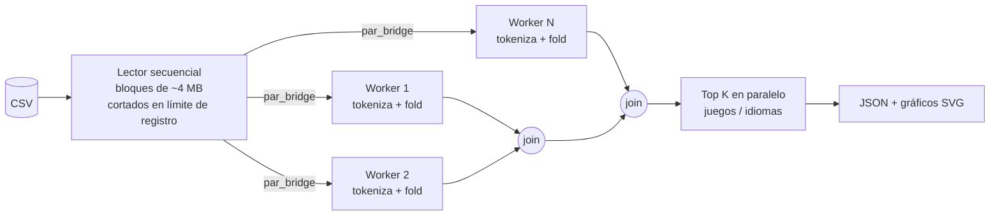
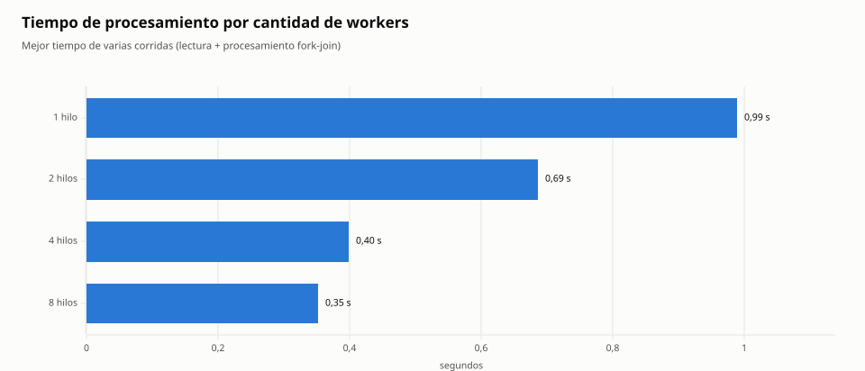
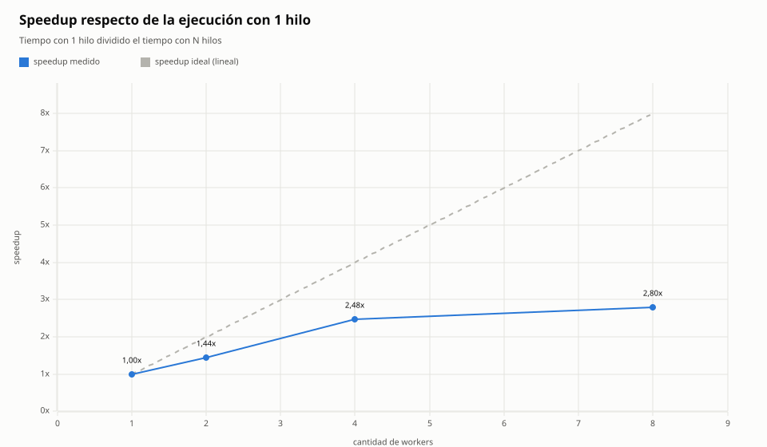
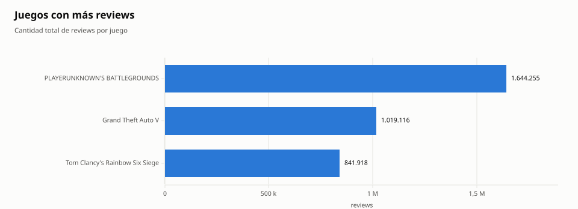
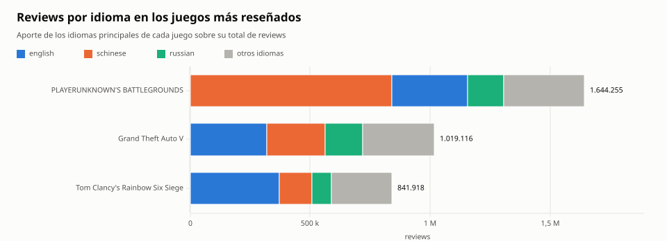
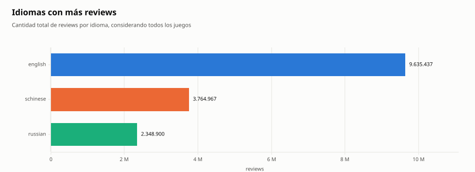
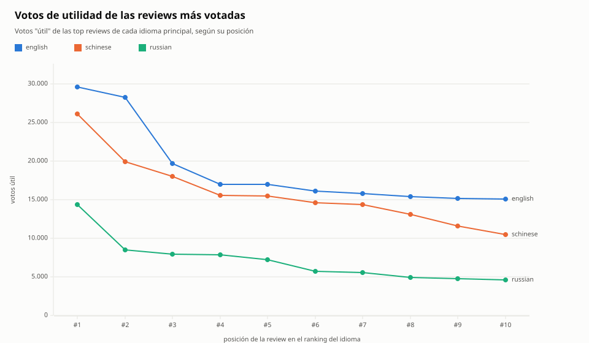

# Steam Reviews Processor

Procesador paralelo de reviews de Steam escrito en Rust. Recorre el dataset
[Steam Reviews 2021](https://www.kaggle.com/datasets/najzeko/steam-reviews-2021) de Kaggle
(~21 millones de reviews, ~8 GB en un único CSV) y calcula en una sola pasada:

- los **juegos con más reviews**, con sus idiomas principales y la review más votada de cada idioma;
- los **idiomas con más reviews** a nivel global, con sus 10 reviews más votadas como útiles.

El procesamiento sigue el modelo **fork-join** sobre [Rayon](https://github.com/rayon-rs/rayon).
Cada worker acumula resultados parciales sin locks ni estado compartido, y los parciales se
fusionan en árbol al final. El resultado se exporta a JSON y, opcionalmente, a gráficos SVG.

> Trabajo práctico 1 de Programación Concurrente (FIUBA, 1C 2025).
> Enunciado: <https://concurrentes-fiuba.github.io/2025_1C_tp1.html>

---

## Arquitectura y concurrencia

### Pipeline fork-join



El núcleo está en [src/processing.rs](src/processing.rs) y usa la pareja `fold` / `reduce` de Rayon:

```rust
batches
    .fold(new_accumulators, |(mut games, mut languages), batch| {   // FORK: un acumulador por worker
        batch.for_each_register(|register| {
            games.consider_review(&register);
            languages.consider_review(&register);
        });
        (games, languages)
    })
    .reduce(new_accumulators, |(mut g, mut l), (g2, l2)| {          // JOIN: fusión en árbol
        g.join(g2);
        l.join(l2);
        (g, l)
    });
```

1. **Fork.** Rayon reparte los bloques entre los workers del pool por *work-stealing*. Cada worker
   mantiene su propio `GamesManager` y `LanguagesManager`, así que la fase de acumulación no tiene
   locks, operaciones atómicas ni contención entre hilos.
2. **Join.** Los acumuladores parciales se fusionan de a pares (`join`), sumando contadores y
   combinando los top K de cada idioma. La fusión es asociativa y conmutativa, por eso el orden en
   que Rayon combina los resultados no altera la salida.
3. **Filtrado.** Sobre el acumulador global se aplica el algoritmo top K, también como
   `fold`/`reduce` paralelo, para quedarse con los 3 juegos y los 3 idiomas principales.

### Lectura: paralelizar también el parseo del CSV

El dataset de Kaggle es **un único archivo**, así que paralelizar por archivo no alcanza. El
lector ([src/utils/io.rs](src/utils/io.rs)) divide el trabajo así:

| Etapa | Hilo | Costo |
|---|---|---|
| Leer ~4 MB del archivo y ubicar el último fin de registro | lector (secuencial) | `memcpy` + `memchr` |
| Tokenizar el CSV, validar UTF-8 y parsear campos | **workers (paralelo)** | dominante |
| Actualizar los acumuladores | **workers (paralelo)** | dominante |

El corte de bloques se apoya en una propiedad de los CSV RFC 4180, que es el formato que genera
pandas: toda comilla literal va duplicada dentro de un campo entre comillas. Por lo tanto, un `\n`
termina un registro **si y sólo si la cantidad de comillas vistas hasta él es par**. Con
`memchr2` el lector salta directamente entre comillas y saltos de línea, sin tokenizar.

### Decisiones de diseño orientadas al rendimiento

- **Zero-copy en el camino caliente.** `ReviewRegister<'a>` toma prestados sus campos (`&str`)
  del bloque leído, y cada worker reutiliza un único `ByteRecord` por bloque. No hay asignaciones
  de memoria por registro.
- **Copiar sólo lo que se guarda.** El texto de una review se copia únicamente si entra en un top
  K. `TopK::admits` decide en O(1), comparando contra el mínimo del heap, sin construir el elemento.
  El nombre de un idioma o juego se copia sólo la primera vez que aparece.
- **Un solo lookup por registro.** Los juegos usan la API `Entry` del `HashMap`. Los idiomas se
  buscan con `&str`, sin crear un `String` por fila.
- **`TopK<T>` con min-heap** ([src/utils/top_k.rs](src/utils/top_k.rs)). Inserción en O(log k),
  descarte en O(1) y reemplazo in-place con `peek_mut`: un solo *sift-down* en lugar de `pop` + `push`.
- **Determinismo.** Todos los órdenes tienen desempate total (votos → texto; reviews → nombre),
  así que la salida es idéntica byte a byte con 1 o con N workers. Hay tests que lo verifican.

### Rendimiento

Medido con el binario `scaling` sobre un CSV de 255 MB (la muestra del repositorio replicada
2000 veces, ~880 mil reviews), en un AMD Ryzen 7 3700U (4 núcleos / 8 hilos). Se toma el mejor
tiempo de 3 a 5 corridas.

| Workers | Versión anterior | Versión actual | Mejora |
|:-:|:-:|:-:|:-:|
| 1 | 1,21 s | 0,94 s | 1,3x |
| 2 | 2,22 s | 0,57 s | 3,9x |
| 4 | 3,04 s | 0,38 s | 8,0x |
| 8 | 3,09 s | 0,33 s | **9,3x** |

En la versión anterior, `par_bridge` entregaba **un registro por vez** bajo un mutex y cada fila
clonaba el texto completo de la review, así que agregar hilos empeoraba el tiempo. La versión
actual escala hasta el límite de núcleos físicos. A partir de ahí manda la parte secuencial: la
lectura del archivo y la búsqueda de cortes. Los gráficos siguientes corresponden a una corrida
independiente del benchmark, así que sus valores varían levemente respecto de la tabla.

<p align="center">
  
  
</p>

---

## Métricas extraídas

| Métrica | Detalle |
|---|---|
| `top_games` | Los 3 juegos con más reviews (desempate por nombre). |
| `top_games[].languages` | Los 3 idiomas con más reviews de cada juego, con su review más votada (`top_review`, `top_review_votes`). |
| `top_languages` | Los 3 idiomas con más reviews en todo el dataset. |
| `top_languages[].top_reviews` | Las 10 reviews más votadas como útiles de cada idioma, de mayor a menor. |

Las listas de la salida se emiten ordenadas de mayor a menor. Ejemplo abreviado:

```json
{
  "padron": 110450,
  "top_games": [
    {
      "game": "PLAYERUNKNOWN'S BATTLEGROUNDS",
      "review_count": 1644255,
      "languages": [
        { "language": "schinese", "review_count": 839946, "top_review": "…", "top_review_votes": 19927 }
      ]
    }
  ],
  "top_languages": [
    { "language": "english", "review_count": 9635437, "top_reviews": [{ "review": "…", "votes": 29608 }] }
  ]
}
```

### Gráficos

Los gráficos se generan en SVG con [`plotters`](https://github.com/plotters-rs/plotters) (sólo el
backend SVG, sin dependencias nativas). Cada idioma conserva su color en todos los gráficos y la
paleta es apta para daltonismo. Las imágenes siguientes corresponden al **dataset completo**
(`expected_output.json`).









---

## Instalación, compilación y ejecución

### Requisitos

- Rust **1.88 o superior** (edición 2024). Instalación: <https://rustup.rs>
- El dataset de Kaggle descomprimido en un directorio. El repositorio incluye una muestra en
  [data/steam_reviews_sample.csv](data/steam_reviews_sample.csv) para pruebas rápidas.

### Compilación

```bash
cargo build --release
```

El perfil `release` usa LTO y `codegen-units = 1`. Para medir rendimiento, usá siempre `--release`.

### Ejecución

```bash
# <DIRECTORIO> <NUM_HILOS> <OUTPUT_JSON> [DIRECTORIO_GRAFICOS]
cargo run --release -- ~/Downloads/steam-reviews 8 output.json

# Además genera los gráficos de métricas en ./charts
cargo run --release -- ~/Downloads/steam-reviews 8 output.json charts

# Con la muestra incluida
cargo run --release -- data 4 output.json charts
```

Se procesan todos los archivos `.csv` del directorio. Los argumentos inválidos y los errores de
E/S se informan con un mensaje claro y código de salida distinto de cero, sin *panics*.

### Herramientas auxiliares

```bash
# Gráficos a partir de un JSON ya generado, sin reprocesar el dataset
cargo run --release --bin charts -- expected_output.json docs/charts

# Benchmark de escalabilidad: 1, 2, 4, … hasta MAX_HILOS workers; tabla + gráficos
# scaling <DIRECTORIO> <MAX_HILOS> <DIRECTORIO_GRAFICOS> [REPETICIONES]
cargo run --release --bin scaling -- ~/Downloads/steam-reviews 8 docs/charts 3
```

### Tests

```bash
cargo test --release
```

| Suite | Qué verifica |
|---|---|
| [tests/pipeline_tests.rs](tests/pipeline_tests.rs) | Salida idéntica con 1, 2, 4, 8 y 16 workers. El corte en bloques no pierde ni parte registros (varios tamaños de bloque). Forma del JSON. Errores sin *panic*. Ida y vuelta de `expected_output.json`. |
| [tests/collectors_tests.rs](tests/collectors_tests.rs) | El `join` es independiente de cómo se particionan los datos y del orden de fusión, incluso con empates y con un mismo id con nombres distintos. |
| [tests/top_k_tests.rs](tests/top_k_tests.rs) | `TopK`: orden, capacidad cero, `admits` coherente con `consider_include`. |

La salida con el dataset completo debe coincidir con [expected_output.json](expected_output.json).

---

## Estructura del proyecto

```text
src/
├── main.rs                      # CLI: pool global de Rayon, medición, JSON y gráficos
├── lib.rs                       # Biblioteca compartida por los binarios y los tests
├── processing.rs                # Pipeline fork-join (fold / reduce) y constantes del problema
├── bin/
│   ├── charts.rs                # JSON existente → gráficos SVG
│   └── scaling.rs               # Benchmark de escalabilidad por cantidad de workers
├── collectors/                  # Estado mutable y lógica de negocio (acumuladores)
│   ├── games_collecting/
│   │   ├── games_manager.rs     # HashMap<app_id, GameInfo>: consider / join / top K
│   │   └── game_info.rs         # Contador del juego + LanguagesManager con top 1 por idioma
│   └── languages_collecting/
│       ├── languages_manager.rs # HashMap<idioma, LanguageReviewsInfo>: consider / join / top K
│       └── language_reviews_info.rs # Contador del idioma + TopK<Review>
├── dtos/                        # Estructuras de entrada/salida (serde)
│   ├── review_register.rs       # Registro del CSV con campos prestados (zero-copy)
│   ├── review.rs                # Review y su orden total (votos → texto)
│   ├── game_dto.rs, language_dto.rs, program_output_dto.rs
├── charts/
│   ├── mod.rs                   # ChartsRenderer: gráficos de métricas y de escalabilidad
│   └── palette.rs               # Paleta categórica y asignación estable de color por idioma
└── utils/
    ├── io.rs                    # CLI, lectura por bloques en paralelo, escritura del JSON
    └── top_k.rs                 # TopK<T> genérico sobre min-heap
docs/charts/                     # Gráficos SVG versionados (usados en este README)
tests/                           # Tests de integración
```

Las capas están separadas: los **collectors** concentran el estado y las reglas de agregación, los
**DTOs** sólo transportan y serializan datos, y **utils** contiene piezas reutilizables sin
conocimiento del dominio.

---

## Puntos fuertes

- **Fork-join idiomático y sin locks.** La concurrencia se expresa con `fold`/`reduce` sobre
  acumuladores locales: no hay `Mutex`, `RwLock` ni atómicos en el procesamiento. Rayon balancea la
  carga por *work-stealing* sin particionado manual.
- **Escalabilidad real sobre un único archivo.** El tokenizado CSV también es paralelo, así que
  el speedup no queda limitado por un lector secuencial que parsea todo.
- **Uso de memoria acotado e independiente del tamaño del dataset.** Sólo se mantienen contadores
  por juego e idioma y, como máximo, k reviews por idioma. El texto completo de las reviews nunca
  se acumula, y la memoria en vuelo es de unos pocos bloques de 4 MB.
- **Cero asignaciones por registro** en el camino caliente, gracias al parseo zero-copy y a las
  copias diferidas hasta que un dato realmente se almacena.
- **Resultados deterministas** con cualquier cantidad de hilos: los órdenes totales y la fusión
  asociativa hacen que la salida no dependa del scheduling, y hay tests que lo verifican.
- **Abstracciones reutilizables y tipadas.** `TopK<T: Ord>` sirve para juegos, idiomas y
  reviews. Los métodos `into_*` consumen `self` y expresan transferencias de ownership en el tipo.
- **Robustez.** Los registros mal formados se descartan sin abortar, los valores fuera de rango de
  `votes_helpful` se normalizan, y los errores de E/S o de argumentos se reportan sin *panics*.
- **Observabilidad del rendimiento.** El binario `scaling` mide tiempos y speedup y los grafica,
  así que cualquier cambio se puede validar con números.
